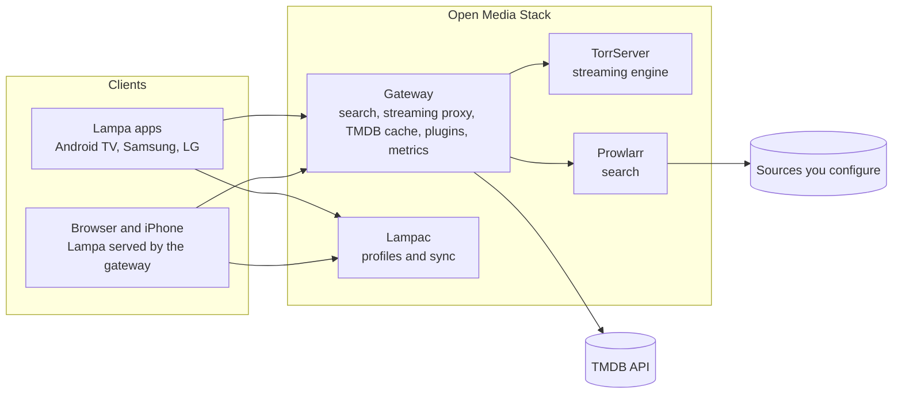

# Open Media Stack

A self-hosted media centre for the [Lampa](https://github.com/yumata/lampa-source) client. One Docker Compose
stack on a home server gives every Lampa device in the house a shared catalogue, search, streaming, profiles and
watch history, with observability built in.

## Features

* **Catalogue** from TMDB: posters, descriptions, ratings, cast, trailers, and catalogue sections by streaming
  service built from TMDB's availability data.
* **Search** through Prowlarr, behind one gateway that ranks results by your language, resolution and HDR
  preferences.
* **Playback** of the release you choose (resolution, HDR, codec, size), with audio-track and subtitle selection.
  Nothing is transcoded, so no graphics card is needed.
* **Profiles and sync:** a "Who's watching?" screen; history, resume positions and bookmarks follow each profile
  across devices, with no third-party account.
* **Clients:** Android TV and Google TV, desktop browsers, iPhone; Samsung and LG TVs through their Lampa apps
  (untested).
* **Security by default:** clients talk only to the gateway; every upstream key stays on the server; secret
  scanning in CI; optional VPN egress for the streaming engine.
* **Observability:** metrics and structured logs from every custom part, Grafana dashboards per stack and
  container, and alerts to Telegram, as an optional separate stack.
* **Operations:** images pinned by digest, backup and restore scripts, measured hardware requirements.

## Architecture



| Component | Role | Upstream | Licence |
|---|---|---|---|
| Gateway | The single entry point for clients; keeps upstream secrets on the server; emits the metrics | this repository | MIT |
| Lampa | Client UI on every platform, extended by this project's plugins; the gateway serves its web build with one added settings script | [yumata/lampa-source](https://github.com/yumata/lampa-source) | GPL-2.0 |
| TorrServer | Streaming engine with a RAM cache; uploading is off | [YouROK/TorrServer](https://github.com/YouROK/TorrServer) | GPL-3.0 |
| Prowlarr | Search across the sources you configure | [Prowlarr/Prowlarr](https://github.com/Prowlarr/Prowlarr) | GPL-3.0 |
| Lampac | Profiles, bookmark and progress sync | [lampac-nextgen/lampac](https://github.com/lampac-nextgen/lampac) | AGPL-3.0 |

Each upstream component runs from its own published image, and the Lampa web build is downloaded from its
upstream repository at install time; this repository contains none of their code. Licence details, including
what the gateway changes in the Lampa build it serves, are in [docs/third-party.md](docs/third-party.md).

## Hardware

Measured on a Raspberry Pi 5 and an amd64 PC: 2 cores and 4 GB RAM for one 1080p stream; 4 cores and 8 GB RAM
for two streams at once, one of them 2160p; 10 GB of disk. Details in [requirements](docs/requirements.md).

## Getting started

New to self-hosting? [Getting started](docs/getting-started.md) goes from nothing to the first playback, step by
step, with a check after each step. Or let [Claude Code set it up with you](docs/ai-setup.md).

Quick start for the impatient:

```bash
git clone https://github.com/krvcho/open-media-stack.git media-stack
cd media-stack
sh scripts/gen-env.sh
docker compose up -d --build
```

Then open `http://<server>:8080/h/<HOUSEHOLD_TOKEN>/` (the token is in `.env`) and add search sources in
Prowlarr ([step 7](docs/install/07-prowlarr-indexers.md)).

## Documentation

* [Getting started](docs/getting-started.md)
* [Install guide](docs/install/README.md), including [Windows 11](docs/install/windows.md),
  [monitoring](docs/install/09-monitoring.md) and [backup](docs/install/10-backup-restore.md)
* [Requirements](docs/requirements.md)
* [Troubleshooting](docs/troubleshooting.md)
* [Third-party software](docs/third-party.md)

## Intended use

Open Media Stack is for media you have the right to watch: your own recordings and copies, films in the public
domain, and works under open licences such as Creative Commons. The project does not support or encourage
copyright infringement.

## Legal

* This repository contains software only. It hosts, ships and links no media and no content, and it configures
  no search source or online source. A CI check keeps content links out of the repository.
* You choose the sources you add, and you are responsible for using them, and for what you watch, in line with
  the law where you live, the rights of the content's owners and each source's terms. Nothing in this repository
  is legal advice.
* The software is provided "as is", without warranty of any kind; see [LICENSE](LICENSE).
* Netflix, HBO Max, Disney+, Apple TV+, Prime Video, SkyShowtime, Canal+, Player and other names are trademarks of
  their owners. They name catalogue sections built from TMDB metadata; this project is not affiliated with,
  endorsed or sponsored by any of them, by TMDB or JustWatch, or by the Lampa, Lampac, TorrServer and Prowlarr
  projects.
* This product uses the TMDB API but is not endorsed or certified by TMDB. Streaming availability data is
  provided by JustWatch through TMDB.

## Licence

[MIT](LICENSE). Upstream components keep their own licences; the full list is in
[docs/third-party.md](docs/third-party.md).
